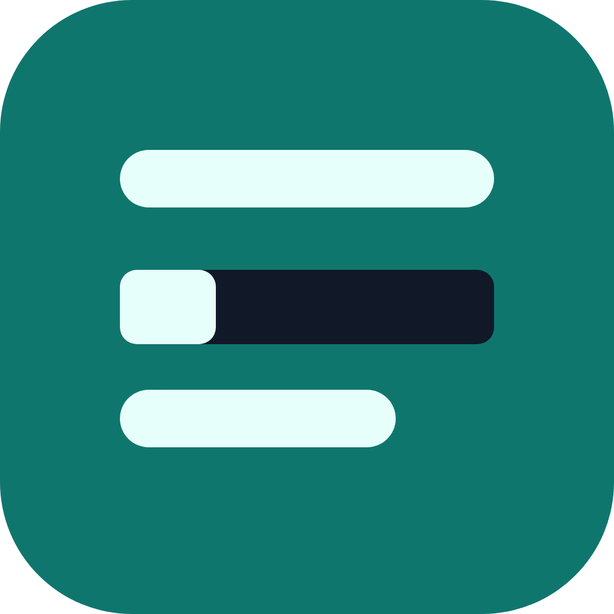

<p align="center">
  
</p>

<h1 align="center">Чёрный заслон</h1>

<p align="center">
  Браузерное расширение, которое не даёт персональным данным уйти в ИИ-чат.<br>
  Телефоны, адреса, СНИЛС, паспорта, счета и карты маскируются до отправки — прямо на устройстве.
</p>

<p align="center">
  <a href="https://github.com/corsi32/chyorny-zaslon/actions/workflows/ci.yml"></a>
  
</p>

> Проект основан на открытом расширении [Offsend](https://github.com/offsend/browser-extension) 0.3.0
> (Apache-2.0) и добавляет к нему поиск персональных данных граждан Российской Федерации.
> Что именно изменено — в [NOTICE](NOTICE) и [CHANGELOG.md](CHANGELOG.md).

## Как это работает

Расширение встраивается в веб-версии ChatGPT, Claude, Gemini, Perplexity, DeepSeek, Grok и Copilot.
Перед отправкой сообщения оно проверяет текст и прикреплённые файлы и в зависимости от режима:

- **Предупреждать** — показывает найденные значения и предпросмотр того, что уйдёт на сервер;
- **Автомаскировка** — заменяет находки подстановками вида `{{PHONE_1_a3f9}}` и отправляет;
- **Блокировать** — не даёт отправить сообщение без маскирования.

Исходные значения хранятся только на устройстве в зашифрованном виде, поэтому в ответе ИИ подстановки
заменяются обратно. Никакой текст сообщений никуда не отправляется.

## Что находит

| Данные | Пример | Как отсекаются случайные числа |
| --- | --- | --- |
| Телефон | `8 (999) 123-45-67`, `89991234567`, `+44 20 7946 0915` | строгие формы записи; 11 цифр слитно — только мобильные коды 9xx и 8-800 |
| Адрес | `101000, г. Москва, ул. Мясницкая, д. 26, кв. 5` | нужен номер дома; индекс сверяется со справочником Почты России |
| СНИЛС | `112-233-445 95` | контрольное число |
| Паспорт РФ | `паспорт 4512 123456`, `45 12 123456` | год бланка в серии и слово «паспорт» или «серия» |
| Банковский счёт | `р/с 40702810938000012345` | слово «р/с», «счёт» рядом или счёт физического лица |
| Карта | `2200 7001 2345 6781` | алгоритм Луна и префикс платёжной системы, в том числе «МИР» |

А также всё, что умел исходный Offsend: ключи API, токены, приватные ключи, email, IBAN, IP-адреса и другие секреты.

Расширение справляется с текстом, скопированным из Word и с сайтов (неразрывные пробелы, тире, невидимые
символы), и с текстом, у которого при вставке пропали переносы строк и значения слиплись.

## Установка

### Готовая сборка

Скачайте архив со страницы [Releases](https://github.com/corsi32/chyorny-zaslon/releases).

- **Chrome и Edge:** распакуйте `*-chrome.zip`, откройте `chrome://extensions`, включите «Режим разработчика»
  и нажмите «Загрузить распакованное».
- **Firefox:** откройте `about:debugging#/runtime/this-firefox` → «Загрузить временное дополнение» → `*-firefox.zip`.

### Из исходного кода

Нужен Node.js 22.

```bash
npm install
npm run build          # сборка для Chrome: .output/chrome-mv3
npm run build:firefox  # сборка для Firefox: .output/firefox-mv2
npm run zip:all        # архивы для магазинов в .output/
```

## Проверка качества

```bash
npm test                # 290 модульных тестов, метрики на размеченном наборе
npm run test:e2e        # 24 сквозных теста в Chromium с установленным расширением
npm run bench           # замер скорости
npm run lint && npm run typecheck
```

| Показатель | Значение |
| --- | --- |
| Точность и полнота на размеченном наборе из 72 текстов | 0,980 |
| Полный скан 50 000 символов всеми встроенными детекторами | в среднем 35,5 мс |
| Случайные строки, на которых проверяются инварианты маскирования | 3000 |

Методы тестирования, алгоритмы детекторов и известные ограничения описаны в
[docs/RU-DETECTORS.md](docs/RU-DETECTORS.md).

## Конфиденциальность

Проверка, маскирование и восстановление выполняются в браузере. Анонимная телеметрия исходного проекта
включается только если при сборке задан `WXT_TELEMETRY_APP_ID`; в сборках этого репозитория он не задан,
и расширение ничего не отправляет в сеть.

## Структура

```
src/core/detection/     движок поиска и детекторы
  ru-address.ts         адреса РФ
  ru-documents.ts       СНИЛС, паспорт, счета, платёжные системы карт
  normalize.ts          нормализация текста
  postal-index.ts       справочник почтовых индексов
src/entrypoints/        фоновый скрипт, скрипт страницы, настройки, всплывающее окно
tests/unit/             модульные тесты
tests/e2e/              сквозные тесты Playwright
tests/corpus/           размеченный набор текстов
docs/                   документация
```

## Лицензия

[Apache License 2.0](LICENSE). Исходный проект — [Offsend](https://github.com/offsend/browser-extension),
© Lab13, Simon Hudishkin. Доработка — © 2026 [corsi32](https://github.com/corsi32). Название «Offsend» принадлежит авторам
исходного проекта. Исходный README сохранён в [docs/UPSTREAM-README.md](docs/UPSTREAM-README.md).

---

**English.** Chyorny Zaslon ("Black Barrier") is a fork of the open-source [Offsend](https://github.com/offsend/browser-extension)
browser extension that adds detectors for Russian personal data — phone numbers, postal addresses validated against
the Russian Post index directory, SNILS, Russian passports, bank accounts and MIR cards — and masks them locally
before a prompt is sent to a web AI chat. Licensed under Apache-2.0.
